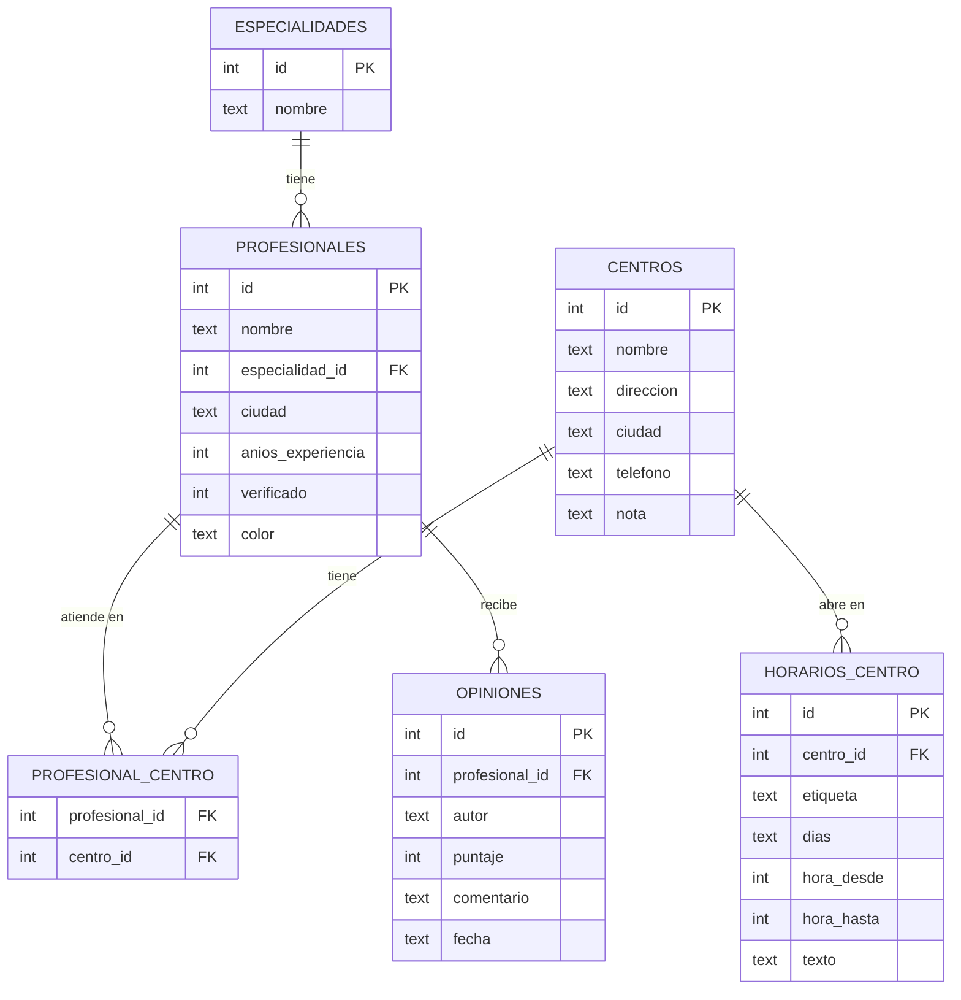

# MediLink — Conectando tu salud

Plataforma de búsqueda y valoración de profesionales de la salud.
Esta carpeta tiene la **versión web**, la **versión móvil** y la **base de datos SQLite**.

## Cómo abrirlo

Hacé doble clic en `index.html` (o directamente en `web/index.html` o `mobile/index.html`).
No hace falta instalar nada. Usa internet solo para cargar la tipografía.

## Estructura

```
medilink/
├── index.html              Portada con acceso a las dos versiones
├── README.md
│
├── database/               Base de datos (SQLite)
│   ├── medilink.db         La base ya creada y con datos de ejemplo
│   ├── schema.sql          Tablas, relaciones, restricciones e índices
│   ├── seed.sql            Datos de ejemplo
│   ├── consultas_ejemplo.sql   Consultas SQL útiles (para el TFI)
│   ├── crear_base.py       Recrea medilink.db desde schema.sql + seed.sql
│   └── export_data.py      Pasa los datos de la base a shared/js/data.js
│
├── shared/                 Lo que usan las dos versiones
│   ├── css/base.css        Colores, tipografía, tarjetas, botones
│   ├── img/logo.png        Logo de MediLink
│   └── js/
│       ├── data.js         Datos (GENERADO desde la base, no editar a mano)
│       ├── icons.js        Íconos y colores de avatar
│       ├── helpers.js      Promedios, horarios "abierto ahora", fechas, avisos
│       ├── views.js        Pantallas: inicio, búsqueda, ranking, centros, perfil
│       └── app.js          Arranque y navegación
│
├── web/
│   ├── index.html          Versión web (menú lateral, portada, grillas)
│   └── css/web.css         Estilos propios de la web
│
└── mobile/
    ├── index.html          Versión móvil (marco de celular, barra inferior)
    └── css/mobile.css      Estilos propios del móvil
```

La web y el móvil comparten la misma lógica (`shared/js`) y la misma base de datos.
Solo cambian el `index.html` y el CSS propio de cada una.

## Modelo de datos



- `profesional_centro` resuelve la relación **muchos a muchos**: un profesional atiende en varios centros y un centro tiene varios profesionales.
- `puntaje` solo acepta valores de 1 a 5 (`CHECK`).
- La vista `vista_profesionales_resumen` calcula el promedio y la cantidad de opiniones de cada profesional.

## Cómo actualizar los datos

1. Editá `database/seed.sql` (o modificá `medilink.db` con un programa como *DB Browser for SQLite*).
2. Si editaste `seed.sql`, recreá la base:
   ```
   cd database
   python crear_base.py
   ```
3. Pasá los datos a la web y al móvil:
   ```
   python export_data.py
   ```
4. Recargá la página.

## Limitaciones actuales

- Los teléfonos, direcciones, horarios y opiniones son **datos de ejemplo**.
- La página lee los datos desde `shared/js/data.js` (exportado de la base). Todavía **no hay un servidor**, así que las opiniones nuevas que se escriben en la página **no se guardan en la base** y se pierden al recargar.
- Siguiente etapa: un servidor (Python o Node) que lea y escriba directamente en `medilink.db`, y registro de usuarios para verificar las opiniones.
